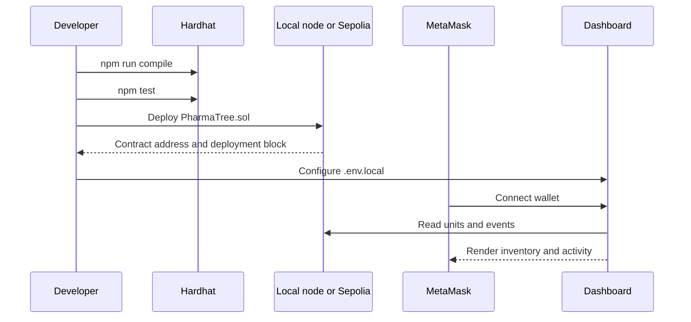
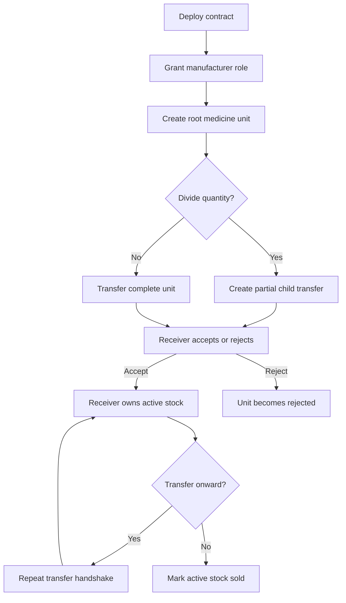
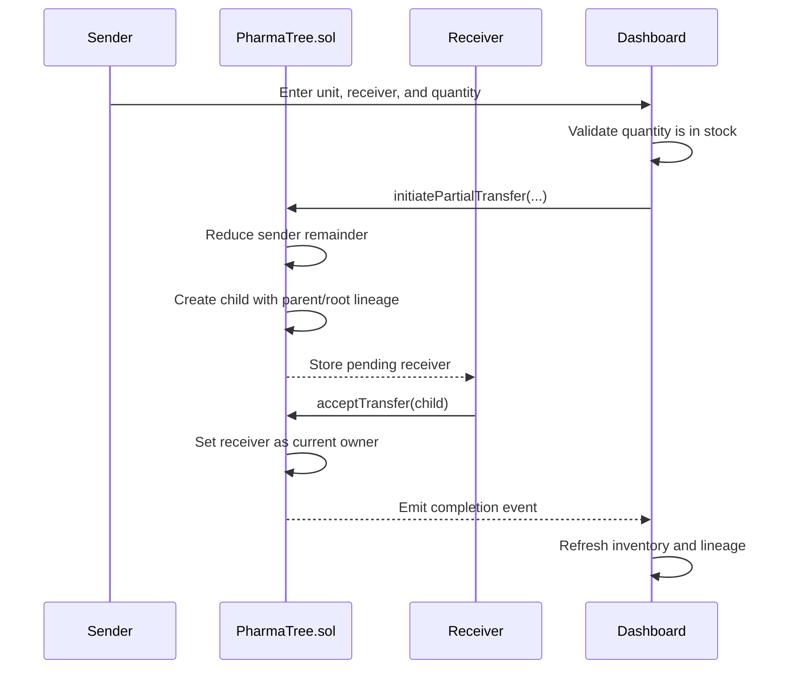
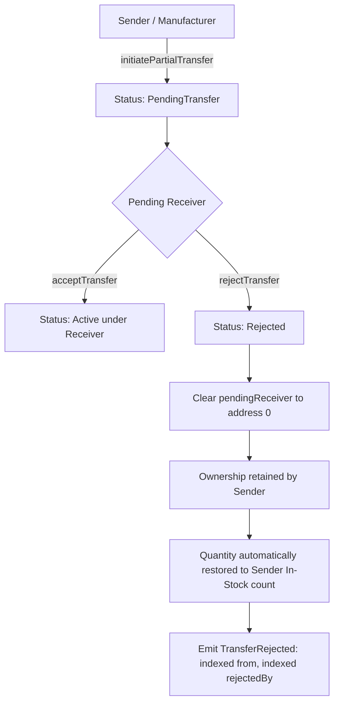
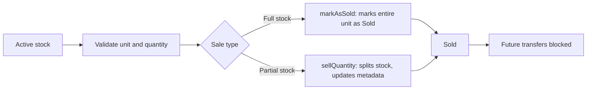
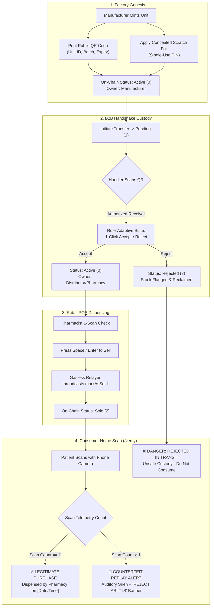

# PharmaTree project documentation

## 1. Purpose

PharmaTree is a blockchain-based pharmaceutical tracking application. It
records medicine provenance from manufacturer creation through authorized
handler transfers and final sale.

The system models a product hierarchy:

```text
Container -> Shipment -> Batch -> Box -> Individual item
```

Every unit has a numeric on-chain ID, parent/root lineage, level, manufacturer,
current owner, pending receiver, status, quantity, and metadata.

## 2. Repository structure

This repository is structured as an enterprise monorepo containing distinct `backend/` and `frontend/` workspaces:

| Path | Responsibility |
| --- | --- |
| `backend/contracts/PharmaTree.sol` | Smart contract logic: RBAC, hierarchy, ownership, transfers, partitioning, rejections, and sales |
| `backend/scripts/` | Sepolia and local Hardhat deployment, role granting, and verification workflows |
| `backend/scripts/agent-production-validator.ts` | Production test suite validating 8 core anti-counterfeit & dispensing invariants against Sepolia |
| `backend/test/PharmaTree.test.ts` | Complete Chai/Mocha smart contract unit test suite (21 test cases passing) |
| `frontend/src/app/` | Next.js 16 App Router pages (`/`, `/create`, `/admin`, `/transfers`, `/inventory`, `/verify`, `/pos`) |
| `frontend/src/app/pos/` | High-throughput Vendor POS QR Scanner Terminal with dual camera/HID wedge listeners |
| `frontend/src/app/api/pos/` | POS backend endpoints: `/verify` (5-tier audit), `/sell` (gasless relayer), `/incident` (quarantine logger) |
| `frontend/src/app/verify/page.tsx` | Public medicine provenance verification & QR audit trail |
| `frontend/src/components/PharmaWalletView.tsx` | Comprehensive reactive wallet dashboard, inventory partitions, rejection UI, and transfer controls |
| `frontend/src/lib/audio-alerts.ts` | Zero-dependency Web Audio API synthesizer for positive chimes & emergency counterfeit sirens |
| `frontend/src/hooks/useHardwareBarcodeScanner.ts` | Global keystroke wedge listener for USB/Bluetooth 2D barcode and QR scanner guns |
| `frontend/src/lib/rpc.ts` | Resilient multi-endpoint FallbackProvider with exponential backoff & rate-limit recovery |
| `frontend/src/lib/pharmaTree.ts` | Frontend ABI, contract addresses, levels, and status mappings |
| `frontend/src/lib/ipfs.ts` | Medicine metadata formatting helper |

## 3. Architecture

### System architecture

```mermaid
flowchart LR
    U[Manufacturer / Handler / Admin] --> MM[MetaMask]
    MM --> UI[Next.js 16 Dashboard]
    UI -->|Resilient Fallback Reads| RPC[Multi-Endpoint RPC Pool]
    UI -->|Signed Transactions| MM
    MM -->|Submit Tx| RPC
    RPC --> C[PharmaTree.sol (0x7c40...198)]
    C --> S[On-chain Unit State & Partitions]
    C --> E[Immutable Audit Events]
    UI --> H[Activity & Inventory Partitions]
    UI --> M[Metadata Formatter]
    M --> C
```

### Application layers

```mermaid
flowchart TB
    Routes[Next.js App Router] --> Wallet[PharmaWalletView]
    Wallet --> Provider[Multi-Endpoint FallbackProvider (rpc.ts)]
    Wallet --> Signer[MetaMask Signer]
    Wallet --> ABI[ABI & Enum Mappings]
    Wallet --> Metadata[Metadata Helper]
    Provider --> Contract[PharmaTree.sol (0x7c40...198)]
    Signer --> Contract
    Contract --> Roles[Access Control Matrix]
    Contract --> Units[Lineage & Stock Partitions]
    Contract --> Events[Immutable Audit Events]
```

The frontend uses a resilient multi-endpoint JSON-RPC fallback provider (`rpc.ts`) that distributes read requests across high-availability Sepolia nodes (Tenderly, PublicNode, 1RPC, Sepolia.org) with automatic backoff on HTTP 429 rate limits. MetaMask supplies the signer for state-changing operations. The smart contract remains the single source of truth for roles, ownership, hierarchy, and status.

## 4. Smart-contract model

### Roles

- **Admin:** grants and removes manufacturer and handler roles.
- **Manufacturer:** creates root medicine units and participates in transfers.
- **Handler:** receives, transfers, accepts, and rejects assigned units.
- **Current owner:** can initiate transfers, create child units where allowed,
  and mark active stock as sold.

The deploying account is initialized as admin and manufacturer.

### Unit levels

The numeric enum order used by the contract and frontend is:

| Value | Level |
| ---: | --- |
| 0 | Container |
| 1 | Shipment |
| 2 | Batch |
| 3 | Box |
| 4 | IndividualItem |

### Statuses

| Value | Status | Meaning |
| ---: | --- | --- |
| 0 | Active | Available for normal ownership operations |
| 1 | PendingTransfer | Transfer initiated and awaiting receiver action |
| 2 | Sold | Finalized and no longer transferable |
| 3 | Rejected | Pending transfer was rejected |

## 5. Application workflows

### End-to-end setup workflow



### Medicine traceability workflow



### Partial transfer and lineage workflow



### Transfer rejection & stock restoration workflow



1. **Cryptographic Protection**: Only the designated `pendingReceiver` can call `rejectTransfer(unitId)`.
2. **Immediate Custody Restitution**: On rejection, `pendingReceiver` is reset to `address(0)`, while `currentOwner` remains with the sender, preventing inventory loss.
3. **Automated Stock Restoration**: In the manufacturer/sender inventory, rejected partition quantities are automatically factored back into available inventory (`currentQuantity = activeUnits + rejectedReturnedUnits`), preventing false stock deficits.
4. **Transparent Two-Way UI Attribution**:
   - **For Rejecter Account**: Recent Activity displays a red `Rejected by You` badge, unit quantity, sender address, and rejection timestamp.
   - **For Sender Account**: Inventory partition row displays `Rejected by 0x...` directly on the tile button, status `Returned to sender`, and audit log `Transfer Rejected: 0x... ➔ Rejected by 0x...`.
   - **Public / Overview View**: Partition rows display `Rejected by 0x...` with exact retained quantities.

### QR Code Verification & Public Provenance (/verify)

PharmaTree provides an open verification portal enabling consumers, pharmacies, and regulators to verify authenticity without requiring Web3 wallets:

```mermaid
flowchart LR
    Pack[Medicine Package / Batch] --> QR[Scannable QR Code]
    QR --> Mobile[Phone camera or browser]
    Mobile --> Page[/verify?unitId=X]
    Page --> RPC[Sepolia JSON-RPC read]
    RPC --> SmartContract[PharmaTree.sol]
    SmartContract --> Audit[Authenticity Badge + Custody Timeline + Etherscan Links]
```

1. **In-Dashboard QR Generation**: Handlers and manufacturers can click **View Public QR Code** on any inventory item or modal to generate, copy, or download a printable high-resolution PNG QR label.
2. **Public Provenance Audit**: Scanning the QR code opens `/verify?unitId=X`, displaying the authenticity status, verified manufacturer wallet, container level, and an immutable chronological custody audit trail with direct links to Sepolia Etherscan.
3. **Manual Unit Search**: Allows manual lookups for any unit ID directly from the verification interface.

### Sale workflow



PharmaTree supports both full and partial quantity sales:
1. **Partial sales (`sellQuantity`)**: The seller can sell any integer quantity $\le$ available stock. The contract creates a new child unit for the sold portion marked as `Sold`, decrements the seller's remaining inventory, and dynamically synchronizes metadata on-chain for both units (e.g. `Paracetamol, 30 tablets`).
2. **Full sales (`markAsSold`)**: Direct sell method that marks the entire unit quantity as `Sold`.
3. The inventory and partition views track partial sales with a dedicated `Partially sold` status badge and display exact sold/active quantity tallies.
4. **Owned inventory detachment**: Sold units (`Status.Sold`) are detached from on-hand owned inventory and total stock volume calculations across dashboard and handler inventory views, ensuring on-hand volume reflects only active and custody-held units.

### Create medicine

An authorized manufacturer or admin creates a root unit with a level, metadata,
and positive quantity. The frontend validates wallet connection, role, name,
and quantity before submitting the transaction.

### Partial transfer

The current owner can transfer all or part of an active unit's quantity to an
authorized receiver. A partial transfer:

1. Validates that the quantity is positive and in stock.
2. Keeps the remainder on the sender's unit.
3. Creates a child transfer unit for the quantity being sent.
4. Records the pending receiver.
5. Requires the receiver to accept or reject the transfer.

Manufacturer views preserve lineage labels such as `1.1`. Handler inventory
uses wallet-local numbering such as `1` and `2`, so units received from
different senders are not incorrectly grouped together.

### Transfer acceptance/rejection

The receiver must be authorized and must match the pending receiver stored on
the unit. Acceptance changes ownership and returns the unit to `Active`.
Rejection clears the pending receiver and sets the unit to `Rejected`.

### Sale & Retail Dispensing

The current owner can mark an active unit as sold either completely (`markAsSold`)
or partially (`sellQuantity`). Partial dispensing splits the stock into an active remainder
and a detached sold child unit with synchronized metadata. Sold units cannot be
transferred or sold again and are detached from on-hand owned inventory tallies.

### Role administration

The admin view grants manufacturer and handler roles. The dashboard prevents
non-admin users from granting manufacturer roles and checks receiver
authorization before transfer submission.

## 6. Frontend routes

All routes render the reusable `PharmaWalletView` component with a different
view mode:

| Route | Purpose |
| --- | --- |
| `/` | Overview, status summaries, reactive stock charts, and recent activity |
| `/create` | Create root medicine units (Authorized Manufacturers only) |
| `/admin` | Grant manufacturer and handler roles (Admin only) |
| `/transfers` | Initiate, accept, reject, and review transfers |
| `/inventory` | View owned stock, lineage, partitions, quantity, and rejection status |
| `/verify` | Public consumer provenance verification and QR code audit trail |
| `/pos` | Dedicated high-throughput Vendor POS QR Scanner Terminal with 5-tier counterfeit interception, fractional dispensing, and gasless relayer |

The primary dashboard distinguishes manufacturer-created medicines from handler
inventory. Manufacturer tables preserve creation and lineage context; handler
tables focus on current stock and transfer status. The `/pos` terminal is an optimized,
fullscreen clinical kiosk interface for high-speed retail checkout.

## 7. Vendor POS QR Scanner Terminal & Anti-Counterfeit Engine

The **Vendor POS Terminal** (`/pos`) is designed specifically for pharmacies, hospital dispensaries, and retail checkout counters. It bridges the physical dispensing of medicine with on-chain cryptographic state updates on Ethereum Sepolia.

### 7.1 Dual-Input Hardware & Camera Engine
- **Camera Viewfinder**: 60fps continuous auto-focus camera scanning using `html5-qrcode` with live targeting reticle, camera switcher (environment vs user), and LED torch toggle.
- **Hardware HID Wedge Auto-Listener**: Custom React hook (`useHardwareBarcodeScanner`) that intercepts keystroke sequences from USB or Bluetooth 2D optical barcode and QR scanners (e.g. Zebra, Honeywell, Sunmi). It buffers input with high-speed threshold detection (<50ms inter-keystroke timing) and auto-submits on `Enter`, allowing hands-free scanning without requiring input element focus.

### 7.2 Five-Tier Anti-Counterfeit Interception Matrix

Every scanned unit is passed through a multi-tier cryptographic and state verification audit (`/api/pos/verify`):

| Tier | Check Name | Failure Condition | POS Response & Action |
| :--- | :--- | :--- | :--- |
| **Tier 1** | **Registry Genesis** | `unitId > unitCounter` or `manufacturer == 0x0` | **UNREGISTERED / FAKE QR**: Siren sounds, dispensing blocked, unit quarantined. |
| **Tier 2** | **Anti-Replay** | `status == Status.Sold` (Value: 2) | **ALREADY DISPENSED / CLONED QR**: Siren sounds, duplicate dispensing prevented, incident logged. |
| **Tier 3** | **Custody Audit** | `currentOwner != vendorAddress` | **DIVERTED / STOLEN STOCK**: Warning displayed; flags inventory that bypassed authorized transfer handshakes. |
| **Tier 4** | **Transit Integrity** | `status == Status.Rejected` (Value: 3) | **DAMAGED / COMPROMISED STOCK**: Blocked from sale; was rejected during transit (e.g., cold-chain breach). |
| **Tier 5** | **Physical Scratch Seal** | `PIN != expectedHash / manufacturerSalt` | **TAMPERED PACKAGING / COPIED OUTER QR**: Flags physical box tampering or unauthorized duplicate packaging. |

### 7.3 Scratch-Off Tamper Seals: Physical Two-Factor Authentication (2FA)

#### The Problem: The "Digital-Physical Gap"
A standard QR code printed on the outside of a pharmaceutical box is readable by anyone in the supply chain or retail aisle. A counterfeiter could photograph genuine QR codes and print 1,000 duplicate stickers on boxes filled with fake or adulterated medication. Digital blockchain tokens cannot independently detect an exterior photograph of paper.

#### The Solution: Dual-Key Physical 2FA
PharmaTree implements a physical two-factor anti-counterfeiting mechanism:
1. **Public Factor (Outer Box QR)**: Contains public metadata: `Unit ID`, `Batch #`, `Expiry Date`, `Root ID`.
2. **Concealed Secret Factor (Scratch-Off Seal)**: Beneath an opaque silver latex scratch-off coating (or tamper-evident pull-tab) lies a single-use secret PIN derived from the manufacturer's cryptographic salt:
   $$\text{PIN} = \text{keccak256}(\text{unitId}, \text{manufacturerSecret})[0..4]$$

#### Lifecycle & Usage:
1. **Packaging**: Factory prints the outer QR and applies the scratch-off foil concealing the PIN. The cryptographic salt/hash is registered on-chain or in the manufacturer's secure registry.
2. **Retail Checkout**: The pharmacist scans the outer QR. The terminal displays medicine details and marks `Tamper Seal: Unverified`. The pharmacist scratches the silver foil in front of the patient, enters the 4-digit PIN into the POS, and validates Tier 5.
3. **Consumer Unboxing**: If sold sealed, the patient scratches the coating at home and verifies the PIN on `/verify`. If the foil is already scratched upon purchase, the patient immediately rejects the medicine as compromised.

### 7.4 Gasless Relayer & Fractional Dispensing
- **Sponsored Transactions**: Pharmacies do not need to hold or manage Sepolia ETH. The `/api/pos/sell` endpoint uses an EIP-2771 compatible sponsored relayer wallet (`RELAYER_PRIVATE_KEY`) to broadcast transactions.
- **Dynamic Fractional Dispensing**: Supports 1-tap partial dispensing (e.g., dispensing 1 blister of 10 tablets from a 30-tablet box). The smart contract's `sellQuantity` executes an atomic split: the parent unit retains the remaining balance, and a newly detached child unit is marked as `Sold` on-chain.
- **Digital Patient Receipt**: Generates a verifiable digital receipt QR code containing transaction hash, timestamp, unit ID, and dispensed quantity for patient verification.

### 7.5 Incident Logging & Quarantine Registry
When an item fails any tier check, the terminal locks dispensing and emits an incident payload to `/api/pos/incident`. Incidents are logged to `.data/incidents.json` containing:
- Incident ID (UUID / timestamped)
- Unit ID and raw scan payload
- Precise failure tier and diagnostic message
- Vendor wallet address and terminal ID (`POS-DISPENSARY-01`)
- Browser GPS coordinates (latitude, longitude) for geospatial counterfeit tracing.

### 7.6 Single-Key Rapid POS Checkout Mode
To eliminate checkout bottlenecks, standard counter checkout operates with zero friction:
1. **1-Scan Instant Check**: Cashier scans carton QR with barcode gun or camera.
2. **Keyboard Hotkey**: As soon as Tiers 1-4 pass (<100ms), the cashier presses **`Spacebar`** or **`Enter`** (or taps "Confirm Sale").
3. **Automated Gasless Broadcast**: Sells the unit on Sepolia via the relayer in the background.
4. **Collapsible Tamper Seal**: The Tier 5 scratch PIN input is placed inside a collapsible `<details>` drawer ("Advanced Tamper Inspection (Optional)"), so it never obstructs or slows standard retail checkout.

## 8. End-to-End QR Verification Lifecycle & Role-Adaptive Experience

A single serialized QR code follows a continuous cryptographic lifecycle from factory floor to patient unboxing.



### 8.1 Role-Adaptive Scan Interface
When a QR code is read on `/verify`, the page detects who is scanning:

1. **Consumer View (Public / Patients without Handler Wallet)**:
   - **Interactive Visual Journey Stepper**: Displays an illustrated 4-stage progress line (`1. Genesis Packaged` -> `2. B2B Handshakes` -> `3. Pharmacy POS` -> `4. Patient Check`) with green checkmarks and timestamps.
   - **Authentic First Scan**: If `status == Sold` and `scanCount <= 1`, verifies genuine purchase, displays dispensing pharmacy, batch details, and dosage instructions.
   - **Duplicate / Cloned Scan**: If `status == Sold` and `scanCount > 1`, triggers an auditory alert tone and displays a prominent red warning card:
     > **REJECT AS IT IS (DO NOT ACCEPT OR CONSUME)**  
     > *This QR code was marked SOLD on-chain and has been scanned multiple times. If you did not personally buy this from a registered pharmacy, this packaging QR is a cloned counterfeit duplicate. Refuse acceptance immediately.*

2. **Authorized Handler View (Connected Wallet with Handler/Manufacturer Role)**:
   - **1-Click Inbound Reception Suite**: If the unit is currently in transit to the handler's wallet (`status == PendingTransfer`), displays prominent **"Accept Shipment into Custody"** and **"Reject Damaged / Tampered Shipment"** buttons with direct MetaMask signing.
   - **Upstream Carrier Ancestry**: Displays root ancestor ID, parent container ID, batch remainder, and cold-chain integrity flags.

## 9. Environment configuration

Create local files from the committed templates:

```bash
cp .env.example .env
cp .env.local.example .env.local
```

`.env.example` contains deployment variables such as:

- `RPC_URL` and `PRIVATE_KEY` for local scripts.
- `SEPOLIA_RPC_URL` and `SEPOLIA_PRIVATE_KEY_MANUFACTURER` for Sepolia.
- Optional distributor/manufacturer addresses and keys.
- `ETHERSCAN_API_KEY` for verification.

`.env.local.example` contains browser configuration:

```dotenv
NEXT_PUBLIC_RPC_URL=http://127.0.0.1:8545
NEXT_PUBLIC_CHAIN_ID=31337
NEXT_PUBLIC_PHARMA_TREE_CONTRACT=0xYOUR_DEPLOYED_CONTRACT_ADDRESS
NEXT_PUBLIC_DEPLOYMENT_BLOCK=
NEXT_PUBLIC_PINATA_API_KEY=
NEXT_PUBLIC_PINATA_SECRET_API_KEY=
```

Use chain ID `11155111` and the Sepolia RPC URL for Sepolia. Never commit
`.env`, `.env.local`, private keys, API keys, or real RPC project IDs.

## 10. Local development

From the repository root:

```bash
npm install
npm run compile
npm test
```

Start the local chain:

```bash
npm run node
```

In another terminal, deploy the contract:

```bash
npx hardhat run scripts/deploy.ts --network localhost
```

Set the printed address in `.env.local`, connect MetaMask to
`http://127.0.0.1:8545` with chain ID `31337`, import a funded Hardhat account,
and start the dashboard:

```bash
npm run dev
```

Open <http://localhost:3000>.

## 11. Sepolia deployment

After filling the required values in `.env`:

```bash
npm run deploy:sepolia
npm run deploy:fresh-manufacturer
npm run verify:sepolia
npm run verify:sepolia-two-wallet
```

The fresh manufacturer script deploys a new contract, assigns the manufacturer
role, and updates the local contract address/deployment block configuration.
Use a dedicated Sepolia test wallet with no real funds.

## 12. Validation & Production Quality Assurance

### Automated Testing & Linting:

```bash
npm run compile
npm test
npm run lint
npm run build
```

### Production Sepolia Live Validation Suite:
Execute real-world on-chain invariant testing against Ethereum Sepolia without mocks:

```bash
cd backend && npx hardhat run scripts/agent-production-validator.ts --network sepolia
```

The production validator suite verifies 8 mission-critical operational invariants:
1. **Relayer Solvency**: Verifies gas sponsorship wallet holds sufficient Sepolia ETH (>1.0 ETH).
2. **Tier 1 (Genesis Registration)**: Validates legitimate origin of active Unit #1 under authorized manufacturer `0x6537...1537`.
3. **Tier 1 (Forged QR Interception)**: Verifies out-of-bounds scanned unit (e.g. Unit #9999) is intercepted as `UNREGISTERED_ID` and triggers quarantine sirens.
4. **Tier 2 (Anti-Replay / Double-Dispensing)**: Verifies that previously sold units (Unit #2 with `Status.Sold`) are strictly blocked from re-sale (`ALREADY_SOLD_REPLAY`).
5. **Tier 3 (Anti-Diversion & Custody Mismatch)**: Verifies that stock belonging to another distributor (Unit #8) flags unauthorized custody diversion when scanned by a different vendor.
6. **Tier 4 (Transit Integrity)**: Halts checkout if a unit was flagged with `Status.Rejected` (contaminated or broken seal).
7. **Tier 5 (Physical 2FA Scratch Seal)**: Verifies that only authentic cryptographic scratch PINs matching manufacturer salt pass, while counterfeit PINs fail.
8. **Fractional Dispensing Invariant**: Validates conservation of medication units ($\Sigma Q = \text{const}$) during `sellQuantity` child unit partitioning.

**Empirical Truth Score: 1.000 / 1.000 ⭐ PRODUCTION READY** (8/8 tests passed).

### Smart Contract Unit Test Suite:
The contract unit test suite (`backend/test/PharmaTree.test.ts`) covers:
- Admin and role authorization.
- Root and child unit creation.
- Partial quantity transfers.
- Parent/child packing authorization.
- Transfer acceptance and rejection.
- Ownership changes.
- Sale detachment and transfer prevention.

Manual dashboard checks:

1. Connect a manufacturer wallet.
2. Create medicine and confirm it appears in Overview and Inventory.
3. Grant a handler role.
4. Transfer a full quantity and accept it from the handler wallet.
5. Transfer a partial quantity and verify the sender remainder.
6. Confirm handler inventory uses separate local unit numbers.
7. Try an unauthorized receiver and an over-quantity transfer.
8. Sell active stock and confirm it cannot be transferred afterward.

## 13. Known limitations & future roadmap

- `frontend/src/lib/ipfs.ts` formats metadata locally; production decentralized pinning can be integrated with server-side Pinata/IPFS API endpoints.
- Unit reads iterate through the contract's unit counter with cached log enrichment. In enterprise high-volume settings, an indexing subgraph (The Graph) or indexed event cache would scale querying.
- Contract addresses and network settings are supplied through environment variables and validated against the connected MetaMask network.

## 14. Security and public release

- Keep all secrets in ignored local environment files (`.env`, `.env.local`).
- Use placeholder values in committed templates (`.env.example`, `.env.local.example`).
- Do not expose private keys in scripts, screenshots, logs, issues, or commits.
- Use a dedicated test wallet for local and Sepolia automation.
- Rotate any credential that may have been exposed.

## 15. Author and project links

**Ayon Moitra**

- GitHub: [@ayonm95](https://github.com/ayonm95)
- Repositories:
  - [Pharma (Monorepo)](https://github.com/ayonm95/Pharma)
  - [pharmatree (Public Mirror)](https://github.com/ayonm95/pharmatree)
- LinkedIn: [Ayon Moitra](https://www.linkedin.com/in/ayon-moitra/)

This project is distributed under the [MIT License](./LICENSE).
