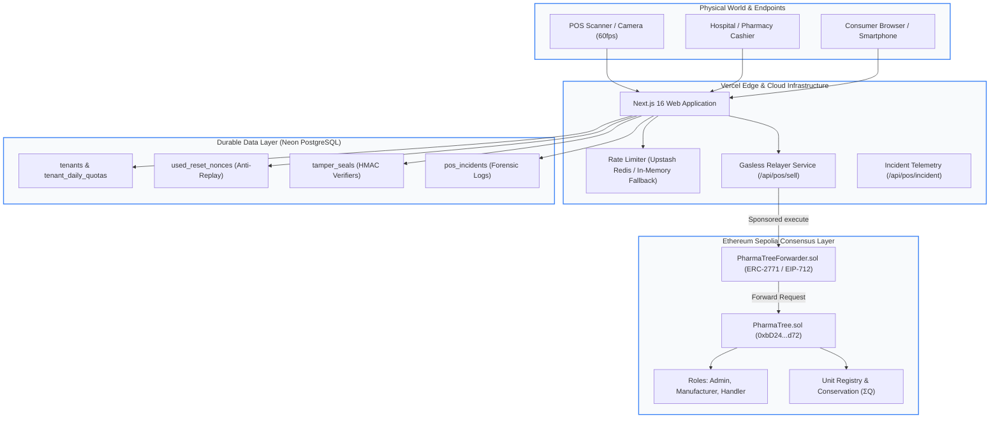

# PharmaTree ✚
### Pharmaceutical Supply Chain Provenance & Verification Engine

[](https://github.com/ayonm95/pharmatree/actions/workflows/ci.yml)
[](https://pharmatree.vercel.app)
[-blue?logo=solidity)](https://soliditylang.org/)
[](https://sepolia.etherscan.io/address/0xbD245c7f7C8bF4A8Ec016e8C370D3e6931BeAd72)
[](https://nextjs.org/)
[](LICENSE)

> [!NOTE]
> **Testnet Prototype & Architecture Specification (Ethereum Sepolia)**  
> PharmaTree is an end-to-end pharmaceutical provenance platform demonstrating hybrid on-chain custody tracking, EIP-712 gasless meta-transactions, GS1 Digital Link packaging standards, and tamper-evident physical seal verification.  
> Detailed formal proofs, mathematical invariant theorems, API references, and audit logs are documented in **[PROJECT_DOCUMENTATION.md](PROJECT_DOCUMENTATION.md)**. Security policy and vulnerability disclosure procedures are in **[SECURITY.md](SECURITY.md)**.

---

## 🌟 Key Capabilities

- **Role-Based Access Control (RBAC)**: On-chain authorization for **Admin**, **Manufacturer**, **Handler** (Distributor, Wholesaler), **Dispenser** (Hospital, Pharmacy), and **QA Auditor** roles. Compromised entities can be revoked immediately, permanently freezing their on-chain custody and dispensing privileges.
- **Hierarchical Lineage Tracking**: Models pharmaceutical packaging hierarchy:
  $$\text{Container} \longrightarrow \text{Shipment} \longrightarrow \text{Batch} \longrightarrow \text{Box} \longrightarrow \text{Individual Item}$$
- **Two-Party Custody Handshake & Audit Trail**: Inbound shipments require mutual acceptance by the authorized recipient. Receivers can reject damaged or compromised shipments, recording an immutable audit trail (`TransferRejected`). Quarantined stock can only be cleared back to active status through verifiable QA audit clearance (`clearRejected(unitId, evidenceHash)`).
- **Inventory Partitioning**: Supports fractional custody transfers (`initiatePartialTransfer`) and partial retail dispensing (`sellQuantity`), preserving sender remainders while detaching new child units.
- **Vendor POS Scanner Terminal (`/pos`)**: High-throughput kiosk scanner for retail dispensaries. Features rapid keyboard checkout (`Spacebar` / `Enter`), collapsible tamper-seal inspection, dual camera/USB-wedge barcode listeners, gasless relayer execution, Web Audio feedback, child unit QR label emission for partial sales, and quarantine incident telemetry.
- **Role-Adaptive Verification Portal (`/verify`)**: 4-Stage visual supply chain journey stepper (`Genesis` -> `Handshakes` -> `POS` -> `Patient Verification`). Connected handlers can accept/reject shipments in 1 click; consumers receive clear guidance driven by physical scratch-off tamper seal verification, distinguishing legitimate prescription rescans from potential cloning.
- **GS1 Digital Link Compliance**: Formats and parses standard GS1 URIs (`/01/{GTIN}/10/{Lot}/21/{Serial}`), Modulo 10 Luhn check digits, ASCII `\x1d` element strings, and 2D GS1 DataMatrix barcodes.
- **Tamper-Evident Physical Seals (Tier 5)**: Combines public packaging QRs with concealed scratch-off Crockford Base32 HMAC secrets to prevent visual photo-cloning. Unguessable serial numbers are verified off-chain via `keccak256` hashes, returning uniform 404 responses to eliminate valid unit enumeration.

---

## 🏛️ System Architecture & Trust Boundaries

PharmaTree operates as a hybrid Web3/Web2 system, balancing decentralized non-repudiation with low-latency retail throughput:



### Trust Boundary Division:
- **Consensus Layer (Sepolia)**: Enforces immutable custody, serial authorization, and mass conservation. The hot relayer key holds **zero roles**; it can only execute forward requests signed by the legitimate unit owner.
- **Database Layer (Neon PostgreSQL)**: Manages rate quotas, used reset nonces, and scratch-off HMAC verifiers behind server-side peppers.
- **Physical Boundary**: Protected via tamper-evident scratch seals. The digital ledger tracks custody transitions, while the physical seal proves packaging has not been unboxed or duplicated.

---

## 📍 Live Deployment (Ethereum Sepolia)

| Parameter | Value |
| :--- | :--- |
| **Network** | Ethereum Sepolia Testnet |
| **Chain ID** | `11155111` |
| **PharmaTree Contract** | [`0xbD245c7f7C8bF4A8Ec016e8C370D3e6931BeAd72`](https://sepolia.etherscan.io/address/0xbD245c7f7C8bF4A8Ec016e8C370D3e6931BeAd72#code) (Verified) |
| **ERC-2771 Forwarder** | [`0x2d24b5b481d0981AE7904790e9d8BF4c162b6c8c`](https://sepolia.etherscan.io/address/0x2d24b5b481d0981AE7904790e9d8BF4c162b6c8c#code) (Verified) |
| **Hot Relayer (0 Roles)** | [`0x335684Cfb813f673fed3f2bb87BF2778D4E96A72`](https://sepolia.etherscan.io/address/0x335684Cfb813f673fed3f2bb87BF2778D4E96A72) |
| **Deployment Block** | `12032098` |
| **Solidity Compiler** | `v0.8.24+commit.e11b9ed9` (Pragma `^0.8.20`) |

### Pre-Configured Test Wallets

| Role | Address | Description |
| :--- | :--- | :--- |
| **Admin & Manufacturer** | `0x65371f0ddFa0AD6e7655243cD2A2567328EA1537` | Deploys contracts, creates batches, administers roles |
| **Primary Handler & Dispenser** | `0x1589df48e9F04926E260Bf813c42dFb4a71893A3` | Authorized distributor / hospital dispensary (`HANDLER_ROLE` + `DISPENSER_ROLE`) |
| **Secondary Handler & QA** | `0xe88a5608B536BCc9d557823234BacA9a00F2540B` | Secondary pharmacy / retail endpoint / QA auditor (`HANDLER_ROLE` + `QA_ROLE`) |

---

## 🛡️ 5-Tier Anti-Counterfeiting Engine

| Tier | Verification Check | Threat Addressed | Action on Failure |
| :--- | :--- | :--- | :--- |
| **Tier 1** | **Registry Genesis & Serial Hash** | Forged barcodes, sequential ID guessing, cloned QRs | **UNIT_NOT_FOUND**: Uniform 404 response preventing ID enumeration |
| **Tier 2** | **Anti-Replay** | Double-dispensing, photocopied carton stickers | **ALREADY_SOLD_REPLAY**: Reverts on-chain, flags duplicate packaging |
| **Tier 3** | **Custody Audit** | Stolen or diverted stock bypassing transfer handshakes | **CUSTODY_MISMATCH**: Flags non-owned inventory (incoming pending shipments display as in-transit) |
| **Tier 4** | **Transit Integrity, Expiry & Recalls** | Contaminated transit, expired medicine, or recalled batches | **REJECTED_TRANSIT / EXPIRED / RECALLED**: Blocks dispensing; requires QA audit clearance |
| **Tier 5** | **Physical Scratch Seal** | Visual photocopies of authentic boxes | **BROKEN / FORGED SEAL**: Requires 12-char Crockford Base32 HMAC |

---

## 🚀 Quick Start

### Prerequisites
- **Node.js**: `>= 20.9.0 (LTS)` (Required by Next.js 16)
- **MetaMask**: Configured for Ethereum Sepolia testnet

### 1. Installation

```bash
# Install backend dependencies
cd backend && npm install && cd ..

# Install frontend dependencies
cd frontend && npm install && cd ..
```

### 2. Configure Environment Variables

Copy `.env.example` to `backend/.env` and `frontend/.env.local`:

```bash
cp .env.example backend/.env
cp .env.example frontend/.env.local
```

Ensure the following variables are configured:
- `SEPOLIA_RPC_URL`: Sepolia RPC provider endpoint.
- `RELAYER_PRIVATE_KEY`: Private key for the unprivileged hot relayer.
- `DATABASE_URL`: Connection string for Neon PostgreSQL.
- `SEAL_PEPPER`: Secret cryptographic pepper for Tier 5 HMAC verifiers.
- `TRUSTED_PROXY`: Reverse proxy trust mode (`vercel` for Vercel edge, `cloudflare`, or `disabled`).
- `DEMO_SANDBOX_ENABLED`: Set to `true` only for staging sandboxes without tenant API keys.
- `ALLOW_LEGACY_SEALS`: Set to `true` to accept Scheme 0 legacy 4-digit PINs (defaults to `false`).
- `UPSTASH_REDIS_REST_URL`: (Optional) Distributed rate limiting.

### 3. Run Development Server

```bash
npm run dev
```

- Main Dashboard: [http://localhost:3000](http://localhost:3000)
- Vendor POS Terminal: [http://localhost:3000/pos](http://localhost:3000/pos)
- Consumer Verification: [http://localhost:3000/verify](http://localhost:3000/verify)
- Health Telemetry: [http://localhost:3000/api/health](http://localhost:3000/api/health)

---

## 🧪 Testing & Validation (123 Automated Tests)

The monorepo maintains **123 automated tests passing** across 10 test suites (70 Hardhat contract & invariant tests + 53 Vitest frontend API security & evaluator tests):

```bash
# Run all smart contract, invariant, and GS1 tests (70 tests)
npm test

# Run frontend API security, tenant auth, and evaluator tests (53 tests)
npm run test:frontend

# Run full test suite across both packages (123 tests)
npm run test:all

# Run linter and type-checking
npm run lint

# Run production Turbopack build
npm run build
```

### Live Sepolia Smoke Verification
To validate against the live deployed Sepolia testnet fixture (#1-#10):

```bash
cd backend && npx hardhat run scripts/e2e-sepolia-validation.ts --network sepolia
```

---

## 📦 Deployment Scripts

To deploy fresh contracts on Sepolia:

```bash
cd backend && npx hardhat run scripts/deploy-and-sync-env.ts --network sepolia
```

To grant roles to an authorized handler:

```bash
cd backend && npx hardhat run scripts/grant-roles.ts --network sepolia
```

---

## 📜 License & Intellectual Property

Copyright (c) 2026 Ayon Moitra. All Rights Reserved.

This software, its smart contracts, backend services, and documentation are proprietary and confidential. Unauthorized copying, modification, commercial redistribution, or operating competing hosted SaaS services is strictly prohibited. See [LICENSE](LICENSE) for full legal terms.
