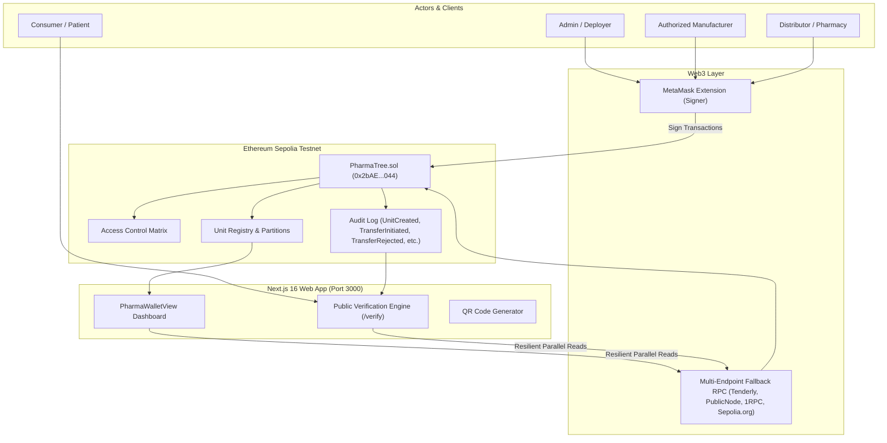
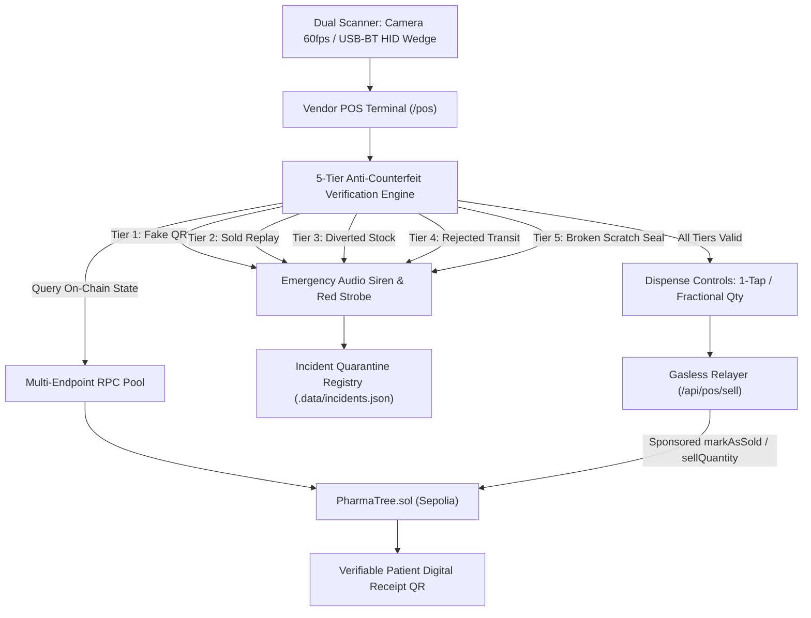

# PharmaTree ✚
### Immutable Blockchain-Based Pharmaceutical Supply Chain Tracking & Verification Engine

[](https://soliditylang.org/)
[](https://sepolia.etherscan.io/)
[](https://nextjs.org/)
[](https://docs.ethers.org/)
[](LICENSE)

PharmaTree is an enterprise-grade decentralized pharmaceutical supply chain tracking platform designed to eliminate counterfeit medicines, secure chain of custody, and provide instant consumer authenticity verification through cryptographic proof on the Ethereum blockchain.

---

## 🌟 Key Capabilities

- **Role-Based Access Control (RBAC)**: Enforces on-chain cryptographic authorization for **Admin**, **Manufacturer**, and **Handler** (Distributor, Wholesaler, Hospital, Pharmacy) roles.
- **Hierarchical Packaging Lineage**: Tracks medicines across 5 distinct supply chain tiers:
  $$\text{Container} \longrightarrow \text{Shipment} \longrightarrow \text{Batch} \longrightarrow \text{Box} \longrightarrow \text{Individual Item}$$
- **Two-Party Custody Handshake & Explicit Rejection Flow**: Prevents inventory interception or unilateral dumping. Inbound shipments require explicit mutual acceptance by the authorized recipient. Receivers can reject suspicious or damaged shipments, automatically returning stock to the sender's inventory while recording a transparent on-chain audit trail (`Rejected by 0x...`).
- **Inventory Partitioning & Detachment**: Supports partial transfers (`initiatePartialTransfer`) and partial retail dispensing (`sellQuantity`), preserving sender remainder while detaching new child units.
- **Vendor POS QR Scanner Terminal (`/pos`)**: High-throughput kiosk scanner for dispensaries, pharmacies, and end vendors. Supports live camera viewfinder and USB/Bluetooth hardware barcode guns (keyboard-wedge). Features a **5-Tier Anti-Counterfeit Interception Engine** (Genesis registration, Anti-replay double-dispensing block, Anti-diversion custody check, Transit integrity inspection, and Cryptographic scratch-off seal verification), instant gasless on-chain sales via relayer sponsor, and synthesized Web Audio sirens and chimes.
- **Consumer Verification & QR Audit Trail**: Dedicated public verification portal (`/verify`) allowing anyone to scan a QR code or search a Unit ID to inspect the full chronological chain of custody without needing a crypto wallet.
- **Resilient Multi-Endpoint Fallback RPC**: Built-in RPC failover engine (`rpc.ts`) with exponential backoff and rate-limit recovery across public Sepolia providers.
- **Real-Time Next.js 16 Web Dashboard**: Responsive UI with automated MetaMask account detection, reactive donut stock charts, and dynamic role panels.

---

## 🏛️ System Architecture



---

## 📍 Live Deployment (Ethereum Sepolia)

| Parameter | Value |
| :--- | :--- |
| **Network** | Ethereum Sepolia Testnet |
| **Chain ID** | `11155111` |
| **Contract Address** | [`0x7c40b82B39346A56Ba69df52A37eBBDfF541b198`](https://sepolia.etherscan.io/address/0x7c40b82B39346A56Ba69df52A37eBBDfF541b198) |
| **Deployment Block** | `11995000` |
| **Solidity Compiler** | `v0.8.20+commit.a1b79de6` |

### Default Test Wallets

| Role | Address | Description |
| :--- | :--- | :--- |
| **Admin & Manufacturer** | `0x65371f0ddFa0AD6e7655243cD2A2567328EA1537` | Deploys contracts, mints batches, grants roles |
| **Distributor / Handler** | `0x1589df48e9F04926E260Bf813c42dFb4a71893A3` | Authorized handler for custody transfer & dispensing |
| **Secondary Handler** | `0xe88a5608B536BCc9d557823234BacA9a00F2540B` | Secondary authorized handler |

---

## 🛒 Vendor POS QR Scanner Terminal & Anti-Counterfeiting Engine (`/pos`)

The **Vendor POS QR Scanner Terminal** is a high-throughput, retail-grade kiosk scanner designed for pharmacies, hospital dispensaries, and end vendors. It connects real-world pharmaceutical dispensing directly to the Ethereum Sepolia blockchain.



### 5-Tier Anti-Counterfeiting Verification Matrix

| Tier | Security Check | Threat Addressed | Enforcement Action |
| :--- | :--- | :--- | :--- |
| **Tier 1** | **Registry Genesis** | Forged barcodes, unregistered batch numbers | **FAKE QR**: siren alarm, locks dispensing, alerts compliance |
| **Tier 2** | **Anti-Replay** | Double-dispensing, photocopied carton stickers | **REPLAY / ALREADY SOLD**: blocks duplicate transaction, quarantines package |
| **Tier 3** | **Custody Audit** | Stolen or diverted stock from other distributors | **CUSTODY MISMATCH**: flags stock that bypassed transfer handshakes |
| **Tier 4** | **Transit Integrity** | Contaminated or damaged batches | **REJECTED TRANSIT**: halts dispensing of compromised deliveries |
| **Tier 5** | **Physical Scratch Seal** | Photocopies of authentic boxes | **BROKEN / FORGED SEAL**: validates single-use concealed cryptographic PIN |

### 🔒 Physical Two-Factor Authentication (2FA): Scratch-Off Tamper Seals
- **The Threat**: An authentic outer QR code can be photographed by anyone along the supply chain and cloned onto 1,000 fake packages.
- **The Solution**: Dual-factor physical security combining *Public Data* (outer QR code) with *Concealed Secret Data* (inner cryptographic PIN underneath an opaque silver scratch-off foil).
- **Verification**: At point of sale, the pharmacist scratches off the foil to reveal the 4-digit PIN ($\text{keccak256}(\text{id}, \text{salt})$). The terminal verifies the PIN before dispensing. If the foil is already scratched or the PIN fails, the item is immediately quarantined.

---

## 📁 Repository Structure

```text
.
├── backend/                  # Smart contract development & Hardhat environment
│   ├── contracts/            # Solidity smart contracts (PharmaTree.sol)
│   ├── test/                 # Chai/Mocha smart contract unit test suite
│   ├── scripts/              # Deployment, role granting & verification scripts
│   │   └── agent-production-validator.ts # Live Sepolia invariant audit suite (Truth Score: 1.000)
│   └── hardhat.config.ts     # Hardhat network & compiler configuration
│
├── frontend/                 # Next.js 16 Web Application (App Router)
│   ├── src/app/              # Next.js routes (overview, create, transfers, inventory, verify, pos)
│   │   ├── pos/              # Dedicated Vendor POS Terminal UI
│   │   └── api/pos/          # POS Backend: /verify, /sell (relayer), /incident
│   ├── src/components/       # Modular UI components (PharmaWalletView, StockDonutChart)
│   ├── src/hooks/            # Custom hooks (useHardwareBarcodeScanner)
│   ├── src/lib/              # Audio alerts synth, RPC failover, ABI definitions
│   └── public/               # Static assets & SVG icons
│
├── .github/workflows/        # Automated CI/CD pipelines
├── package.json              # Root-level unified execution scripts
├── PROJECT_DOCUMENTATION.md  # Detailed technical specifications & data models
└── README.md                 # Primary project overview
```

---

## 🚀 Quick Start

### Prerequisites
- [Node.js](https://nodejs.org/) (v18 or v20+)
- [MetaMask](https://metamask.io/) browser extension configured for Sepolia testnet

### 1. Installation

Install dependencies for both backend and frontend:

```bash
# Install backend dependencies
cd backend && npm install && cd ..

# Install frontend dependencies
cd frontend && npm install && cd ..
```

### 2. Configure Environment Variables

Create `.env` in `backend/` and `.env.local` in `frontend/` (or copy from examples):

**`backend/.env`**:
```env
SEPOLIA_RPC_URL=https://ethereum-sepolia-rpc.publicnode.com
SEPOLIA_PRIVATE_KEY_MANUFACTURER=0x...
SEPOLIA_PRIVATE_KEY_DISTRIBUTOR=0x...
SEPOLIA_CHAIN_ID=11155111
ETHERSCAN_API_KEY=<YOUR_ETHERSCAN_KEY>
SEPOLIA_CONTRACT_ADDRESS=0x7c40b82B39346A56Ba69df52A37eBBDfF541b198
```

**`frontend/.env.local`**:
```env
NEXT_PUBLIC_PHARMA_TREE_CONTRACT=0x7c40b82B39346A56Ba69df52A37eBBDfF541b198
NEXT_PUBLIC_RPC_URL=https://ethereum-sepolia-rpc.publicnode.com
NEXT_PUBLIC_CHAIN_ID=11155111
NEXT_PUBLIC_DEPLOYMENT_BLOCK=11995000
RELAYER_PRIVATE_KEY=0x...
```

### 3. Run Development Server

From the root directory:

```bash
npm run dev
```

Open [http://localhost:3000](http://localhost:3000) for the main dashboard or [http://localhost:3000/pos](http://localhost:3000/pos) for the Vendor POS Scanner Terminal.

---

## 🧪 Testing & Quality Assurance

### 1. Sepolia Live Production Invariant Suite (`agent-production-validator`)
Validates real on-chain behavior against Ethereum Sepolia without mocks:

```bash
cd backend && npx hardhat run scripts/agent-production-validator.ts --network sepolia
```

**Empirical Truth Score: 1.000 / 1.000 ⭐ PRODUCTION READY**
- ✅ **Relayer Solvency Check**: Relayer holds >1.2 ETH on Sepolia for sponsoring gasless POS transactions.
- ✅ **Tier 1 (Genesis Registration)**: Validates legitimate origin of Unit #1 under manufacturer `0x6537...1537`.
- ✅ **Tier 1 (Forged QR Interception)**: Scanned fake Unit #9999 intercepted as `UNREGISTERED_ID`.
- ✅ **Tier 2 (Anti-Replay / Double-Dispensing)**: Sold Unit #2 with `Status.Sold` strictly blocked from re-dispensing (`ALREADY_SOLD_REPLAY`).
- ✅ **Tier 3 (Anti-Diversion & Custody Mismatch)**: Out-of-custody Unit #8 triggers custody mismatch warning when scanned by a different vendor.
- ✅ **Tier 4 (Transit Integrity)**: Halts checkout if a unit was marked as `Status.Rejected` during delivery.
- ✅ **Tier 5 (Physical 2FA Scratch Seal)**: Validates single-use 4-digit PIN matching cryptographic manufacturer salt.
- ✅ **Fractional Dispensing Invariant**: Validates mathematical conservation of units ($\Sigma Q = \text{const}$) during `sellQuantity` child unit partitioning.

### 2. Smart Contract Unit Test Suite
Run the 21-scenario Chai/Mocha smart contract unit test suite:

```bash
# Run smart contract unit tests from root
npm test

# Run tests and validate frontend production build
npm run test:all
```

Test coverage includes:
- Role assignment and permission denial
- Hierarchical unit creation and owner permissions
- Two-party transfer handshake (initiate, accept, reject)
- Receiver authorization verification
- Partial unit quantity splitting (`initiatePartialTransfer`)
- Partial dispensing (`sellQuantity`) and complete unit sale detachment

---

## 📦 Deployment & Verification Workflows

To deploy a fresh instance of the smart contract to Sepolia and automatically update all frontend and backend configuration files:

```bash
npm run deploy:sepolia
```

To grant roles to the distributor account on Sepolia:

```bash
npm --prefix backend run hardhat run --network sepolia scripts/grant-roles.ts
```
One click contract address update and maufacturer to default depoloyer account

```bash
npx hardhat run scripts/deploy-and-sync-env.ts --network sepolia
```


---

## 📜 License

This project is licensed under the MIT License.
