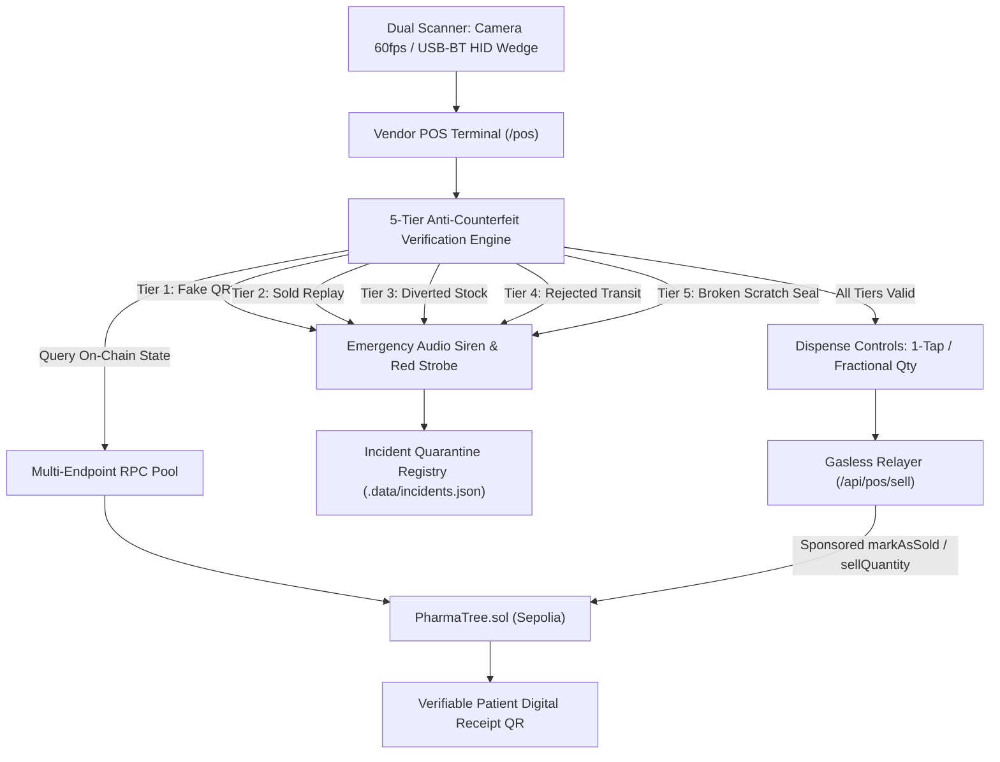

# PharmaTree ✚
### Decentralized Pharmaceutical Supply Chain Tracking & Verification Engine

[](https://github.com/ayonm95/pharmatree/actions/workflows/ci.yml)
[](https://pharmatree.vercel.app)
[](https://soliditylang.org/)
[](https://sepolia.etherscan.io/address/0xbD245c7f7C8bF4A8Ec016e8C370D3e6931BeAd72)
[](https://nextjs.org/)
[](LICENSE)

PharmaTree is a decentralized pharmaceutical supply chain tracking platform designed to provide tamper-evident provenance, verifiable custody handshakes, zero double-dispensing, and instant consumer authenticity verification through cryptographic proof on the Ethereum blockchain.

---

## 🌟 Key Capabilities

- **Role-Based Access Control (RBAC)**: Enforces on-chain cryptographic authorization for **Admin**, **Manufacturer**, and **Handler** (Distributor, Wholesaler, Hospital, Pharmacy) roles.
- **Hierarchical Packaging Lineage**: Tracks medicines across 5 distinct supply chain tiers:
  $$\text{Container} \longrightarrow \text{Shipment} \longrightarrow \text{Batch} \longrightarrow \text{Box} \longrightarrow \text{Individual Item}$$
- **Two-Party Custody Handshake & Explicit Rejection Flow**: Prevents inventory interception or unilateral dumping. Inbound shipments require explicit mutual acceptance by the authorized recipient. Receivers can reject suspicious or damaged shipments, automatically returning stock to the sender's inventory while recording a transparent on-chain audit trail (`Rejected by 0x...`).
- **Inventory Partitioning & Detachment**: Supports partial transfers (`initiatePartialTransfer`) and partial retail dispensing (`sellQuantity`), preserving sender remainder while detaching new child units.
- **Vendor POS QR Scanner Terminal (`/pos`)**: High-throughput kiosk scanner for dispensaries, pharmacies, and end vendors. Features single-key fast checkout (press `Spacebar` or `Enter` to dispense in `<500ms`), collapsible tamper seal inspection, dual camera/USB-wedge barcode listeners, gasless relayer transactions, Web Audio synthesizers, and quarantine incident logging.
- **Role-Adaptive Public Verification (`/verify`)**: 4-Stage interactive visual journey stepper (`Genesis` -> `Handshakes` -> `POS` -> `Patient Check`). Detects connected handler wallets to surface 1-click `[Accept Shipment into Custody]` and `[Reject Damaged / Tampered Shipment]` actions, while providing clear, nuanced scan history telemetry.
- **Defense-in-Depth Security Hardening**: Strict Content Security Policy (CSP), HTTP Strict Transport Security (HSTS), X-Frame-Options (`DENY`), X-Content-Type-Options (`nosniff`), Permissions-Policy, sliding-window in-memory rate limiting (`rateLimit.ts`), input boundary sanitization, and React 19 Client Error Boundaries (`error.tsx`, `global-error.tsx`).
- **Production Health & Diagnostic Telemetry (`/api/health`)**: Real-time observability endpoint reporting Sepolia RPC latency, latest block number, smart contract availability, unit counters, and gasless relayer solvency.
- **Resilient Multi-Endpoint Fallback RPC**: Built-in RPC failover engine (`rpc.ts`) with exponential backoff and rate-limit recovery across public Sepolia providers.
- **Real-Time Next.js 16 Web Dashboard**: Responsive UI with automated MetaMask account detection, reactive donut stock charts, and dynamic role panels.

---

## 🏛️ System Architecture


---

## 📍 Live Deployment (Ethereum Sepolia)

| Parameter | Value |
| :--- | :--- |
| **Network** | Ethereum Sepolia Testnet |
| **Chain ID** | `11155111` |
| **PharmaTree Contract** | [`0xbD245c7f7C8bF4A8Ec016e8C370D3e6931BeAd72`](https://sepolia.etherscan.io/address/0xbD245c7f7C8bF4A8Ec016e8C370D3e6931BeAd72) |
| **ERC-2771 Forwarder** | [`0x2d24b5b481d0981AE7904790e9d8BF4c162b6c8c`](https://sepolia.etherscan.io/address/0x2d24b5b481d0981AE7904790e9d8BF4c162b6c8c) |
| **Deployment Block** | `12032098` |
| **Solidity Compiler** | `v0.8.24+commit.e11b9ed9` |

### Default Test Wallets

| Role | Address | Description |
| :--- | :--- | :--- |
| **Admin & Manufacturer** | `0x65371f0ddFa0AD6e7655243cD2A2567328EA1537` | Deploys contracts, mints batches, grants roles |
| **Distributor / Handler** | `0x1589df48e9F04926E260Bf813c42dFb4a71893A3` | Authorized handler for custody transfer & dispensing |
| **Secondary Handler** | `0xe88a5608B536BCc9d557823234BacA9a00F2540B` | Secondary authorized handler |

---

## 🛒 Vendor POS QR Scanner Terminal & Anti-Counterfeiting Engine (`/pos`)

The **Vendor POS QR Scanner Terminal** is a high-throughput, retail-grade kiosk scanner designed for pharmacies, hospital dispensaries, and end vendors. It connects real-world pharmaceutical dispensing directly to the Ethereum Sepolia blockchain.



### 5-Tier Anti-Counterfeiting Verification Matrix

| Tier | Security Check | Threat Addressed | Enforcement Action |
| :--- | :--- | :--- | :--- |
| **Tier 1** | **Registry Genesis** | Forged barcodes, unregistered batch numbers | **FAKE QR**: siren alarm, locks dispensing, alerts compliance |
| **Tier 2** | **Anti-Replay** | Double-dispensing, photocopied carton stickers | **REPLAY / ALREADY SOLD**: blocks duplicate transaction, quarantines package |
| **Tier 3** | **Custody Audit** | Stolen or diverted stock from other distributors | **CUSTODY MISMATCH**: flags stock that bypassed transfer handshakes |
| **Tier 4** | **Transit Integrity** | Contaminated or damaged batches | **REJECTED TRANSIT**: halts dispensing of compromised deliveries |
| **Tier 5** | **Physical Scratch Seal** | Photocopies of authentic boxes | **BROKEN / FORGED SEAL**: validates single-use concealed cryptographic PIN |

### ⚡ Single-Key Rapid POS Checkout Mode
- **Zero Friction**: Standard retail checkout is 1-scan with zero manual typing required.
- **Keyboard Hotkey**: As soon as Tiers 1-4 pass (<100ms), the cashier simply presses **`Spacebar`** or **`Enter`** (or taps the button) to instantly broadcast the sale on Sepolia via the gasless relayer.
- **Collapsible Tamper Seal**: The Tier 5 scratch PIN is placed inside a collapsible `<details>` drawer ("Advanced Tamper Inspection (Optional)") so it never obstructs or slows down standard retail lines.

---

## 🔍 Public Consumer Verification & Role-Adaptive QR Experience (`/verify`)

The single QR code generated at packaging adapts dynamically depending on whether a consumer or an authorized handler scans it:

### 1. Interactive Visual Journey Stepper (For Patients & Consumers)
Non-technical consumers are greeted with an illustrated 4-stage supply chain journey:
$$\text{1. Genesis Packaged} \longrightarrow \text{2. B2B Handshakes} \longrightarrow \text{3. Pharmacy POS} \longrightarrow \text{4. Patient Verification}$$

- **Authentic First Scan**: If `status == Sold` and scanned for the first time at home, verifies legitimate purchase with dispensing pharmacy address, batch expiry, and dosage.
- **🚨 Replay Rejection Warning**: If `status == Sold` and `scanCount > 1`, triggers an auditory alert siren and renders a prominent red alert card:
  > **REJECT AS IT IS (DO NOT ACCEPT OR CONSUME)**  
  > *This QR code was marked SOLD on-chain and has been scanned multiple times. Counterfeiters commonly clone sold stickers onto fake boxes. If you did not personally buy this from the registered pharmacy, refuse acceptance immediately.*

### 2. Authorized Handler Reception Suite (For Logistics & Pharmacies)
When an authorized handler scans an inbound shipment with their connected Web3 wallet:
- **1-Click Accept / Reject**: Displays direct **"Accept Shipment into Custody"** and **"Reject Damaged / Tampered Shipment"** buttons with MetaMask signing.
- **Logistics Diagnostics**: Surfaces root ancestor ID, parent container ID, dispatch timestamp, and cold-chain integrity flags.

---

## 📁 Repository Structure

```text
.
├── backend/                  # Smart contract development & Hardhat environment
│   ├── contracts/            # Solidity smart contracts (PharmaTree.sol, PharmaTreeForwarder.sol)
│   ├── test/                 # Chai/Mocha smart contract unit test suite (65 automated tests)
│   ├── scripts/              # Deployment, role granting & verification scripts
│   │   └── e2e-sepolia-validation.ts # Live Sepolia invariant audit suite (8/8 Invariants Passing)
│   └── hardhat.config.ts     # Hardhat network & compiler configuration
│
├── frontend/                 # Next.js 16 Web Application (App Router)
│   ├── src/app/              # Next.js routes (overview, create, transfers, inventory, verify, pos)
│   │   ├── pos/              # Dedicated Vendor POS Terminal UI
│   │   └── api/pos/          # POS Backend: /verify, /sell (relayer), /incident
│   ├── src/components/       # Modular UI components (PharmaWalletView, StockDonutChart)
│   ├── src/hooks/            # Custom hooks (useHardwareBarcodeScanner)
│   ├── src/lib/              # Audio alerts synth, RPC failover, ABI definitions
│   └── public/               # Static assets & SVG icons
│
├── .github/workflows/        # Automated CI/CD pipelines
├── package.json              # Root-level unified execution scripts
├── PROJECT_DOCUMENTATION.md  # Detailed technical specifications & data models
└── README.md                 # Primary project overview
```

---

## 🚀 Quick Start

### Prerequisites
- [Node.js](https://nodejs.org/) (v18 or v20+)
- [MetaMask](https://metamask.io/) browser extension configured for Sepolia testnet

### 1. Installation

Install dependencies for both backend and frontend:

```bash
# Install backend dependencies
cd backend && npm install && cd ..

# Install frontend dependencies
cd frontend && npm install && cd ..
```

### 2. Configure Environment Variables

Create `.env` in `backend/` and `.env.local` in `frontend/` (or copy from examples):

**`backend/.env`**:
```env
SEPOLIA_RPC_URL=https://ethereum-sepolia-rpc.publicnode.com
SEPOLIA_PRIVATE_KEY_MANUFACTURER=0x...
SEPOLIA_PRIVATE_KEY_DISTRIBUTOR=0x...
SEPOLIA_CHAIN_ID=11155111
ETHERSCAN_API_KEY=<YOUR_ETHERSCAN_KEY>
SEPOLIA_CONTRACT_ADDRESS=0xbD245c7f7C8bF4A8Ec016e8C370D3e6931BeAd72
TRUSTED_FORWARDER=0x2d24b5b481d0981AE7904790e9d8BF4c162b6c8c
```

**`frontend/.env.local`**:
```env
NEXT_PUBLIC_PHARMA_TREE_CONTRACT=0xbD245c7f7C8bF4A8Ec016e8C370D3e6931BeAd72
NEXT_PUBLIC_TRUSTED_FORWARDER=0x2d24b5b481d0981AE7904790e9d8BF4c162b6c8c
NEXT_PUBLIC_RPC_URL=https://ethereum-sepolia-rpc.publicnode.com
NEXT_PUBLIC_CHAIN_ID=11155111
NEXT_PUBLIC_DEPLOYMENT_BLOCK=12032098
RELAYER_PRIVATE_KEY=0x...
```

### 3. Run Development Server

From the root directory:

```bash
npm run dev
```

Open [http://localhost:3000](http://localhost:3000) for the main dashboard or [http://localhost:3000/pos](http://localhost:3000/pos) for the Vendor POS Scanner Terminal.

---

## 🧪 Testing & Quality Assurance

### 1. Sepolia Live Invariant Suite (`e2e-sepolia-validation.ts`)
Validates real on-chain behavior against Ethereum Sepolia without mocks:

```bash
cd backend && npx hardhat run scripts/e2e-sepolia-validation.ts --network sepolia
```

**Result: 8/8 live Sepolia invariant checks passing ✅**
- ✅ **Relayer Solvency Check**: Relayer holds >1.2 ETH on Sepolia for sponsoring gasless POS transactions (threshold $\ge 0.005$ ETH).
- ✅ **Tier 1 (Genesis Registration)**: Validates legitimate origin of Unit #1 under manufacturer `0x6537...1537`.
- ✅ **Tier 1 (Forged QR Interception)**: Scanned fake Unit #9999 intercepted as `UNREGISTERED_ID`.
- ✅ **Tier 2 (Anti-Replay / Double-Dispensing)**: Sold Unit #2 with `Status.Sold` strictly blocked from re-dispensing (`ALREADY_SOLD_REPLAY`).
- ✅ **Tier 3 (Anti-Diversion & Custody Mismatch)**: Out-of-custody Unit #8 triggers custody mismatch warning when scanned by a different vendor.
- ✅ **Tier 4 (Transit Integrity)**: Halts checkout if a unit was marked as `Status.Rejected` during delivery.
- ✅ **Tier 5 (Physical 2FA Scratch Seal)**: Validates single-use 4-digit PIN matching cryptographic manufacturer salt.
- ✅ **Fractional Dispensing Invariant**: Validates mathematical conservation of units ($\Sigma Q = \text{const}$) during `sellQuantity` child unit partitioning.

---

## 🛡️ Threat Model & Security Matrix

A blockchain is a deterministic ledger of recorded events, not a physical spectrometer. To present an honest, production-grade security posture, PharmaTree delineates explicit defensive boundaries:

### Comprehensive Threat-Model Matrix

| Attack Vector | Threat Scenario | Mitigating Mechanism / Stopping Tier | Residual / Out-of-Scope Risks |
| :--- | :--- | :--- | :--- |
| **Photocopied QR Sticker** | Counterfeiter photocopies authentic box QR code and affixes to fake carton | **Tier 2 Anti-Replay Lock**: `sellQuantity` & `markAsSold` atomically lock unit status on-chain. Second dispense attempt reverts immediately (`Status.Sold`). | If the counterfeit is dispensed before the genuine medicine, the genuine medicine is rejected. Mitigated by Tier 5 scratch seals on high-risk drugs. |
| **Forged Unit Barcode** | Adversary fabricates random QR codes or non-existent serial numbers | **Tier 1 Genesis Registration**: Bounds check against `unitCounter` and manufacturer genesis address in `getUnitDetails`. | None. Unregistered IDs fail deterministically. |
| **Inventory Diversion & Theft** | Stolen shipment redirected to black-market pharmacy | **Tier 3 Custody Handshake**: Verifies dispenser matches on-chain `currentOwner`. Handshakes require explicit recipient `acceptTransfer`. | Physical theft occurring after legitimate pharmacy dispensing. |
| **Damaged / Recalled Batch Dispensing** | Sub-potent or temperature-compromised shipment dispensed to patient | **Tier 4 Transit Integrity**: Explicit receiver rejection transitions unit to `Status.Rejected`, preventing sale until audit clearance. | Undetected cold-chain breaks where no handler records transit rejection. |
| **Scratch Seal Brute-Force DoS** | Attacker repeatedly submits bad guesses to lock genuine pharmacy seals | **Client-Partitioned Exponential Backoff**: Failed attempts partitioned by `(unitId, clientIpHash)`. Attacker locked out after 3–5 attempts; legitimate pharmacy is unaffected. | Attacker cycling rotating proxies; mitigated by $32^{12} \approx 1.15 \times 10^{18}$ Crockford Base32 entropy. |
| **Gasless Relayer Exploitation** | Malicious client drains relayer gas balance through public sell endpoints | **Authenticated Forwarder & Gas Quotas**: EIP-712 forward request signer must match `currentOwner`. Max 50 tx/day per vendor; automatic 503 cutoff below 0.001 ETH balance. | Mempool congestion spikes; mitigated by multi-provider fallback RPC and retry backoff. |
| **Relayer Liveness & Solvency DoS** | Relayer runs out of native ETH or relayer API crashes | **Censorship-Resistant Direct Fallback**: POS automatically triggers direct dispensary signing (`requiresClientSigning: true`) via injected browser wallet (MetaMask). | **Explicit Trust Assumption**: Relayer liveness is an off-chain UX optimization for gasless dispensing, not an availability dependency. The smart contract remains fully self-executable. |
| **Server / Relayer Compromise** | Attacker compromises backend server hosting `RELAYER_PRIVATE_KEY` | **Role Decoupling (ERC-2771)**: Relayer EOA holds ZERO roles in `PharmaTree.sol`. Attacker cannot mint units, grant roles, or sell unowned inventory without vendor signatures. | Attacker draining native Sepolia ETH from the relayer wallet. |
| **Server-Held HMAC Key Leak (`SEAL_PEPPER`)** | Attacker extracts server environment variables | **Versioned Cryptographic Verifiers**: Seal verifiers are stored as one-way HMACs with version prefixes (`v1:`). Plaintext secrets are never stored in DB. | **Explicit Trust Assumption**: Confidentiality of `SEAL_PEPPER` relies on secure server secrets management. Key rotation (`v2:`) and KMS hardware isolation limit blast radius. |
| **"Garbage In, Garbage Out"** | Corrupt manufacturer mints batches with falsified active ingredients | **Out of Scope (Physical Reality Gap)**: Blockchain ledger accurately records fraudulent genesis. Regulatory GMP audits and physical lab inspections required. | Physical chemical composition cannot be deduced from digital cryptography alone. |

---

## 🔬 Architectural Review Lenses

Rather than relying on isolated opinions, PharmaTree's architecture was evaluated across five rigorous engineering review lenses:

### 1. The Physics & Packaging Lens
- **Principle**: A digital token cannot enforce physical molecular authenticity.
- **Implementation**: The system combines on-chain state with physical tamper-evident tear tapes and dual-scheme scratch-off foils (Scheme 0 legacy 4-digit PIN for low-friction units, Scheme 1 12-char Crockford Base32 HMAC for high-value lots). Physical packaging must be visibly disrupted to access the secret.

### 2. The Regulatory & Interoperability Lens
- **Principle**: Supply chain software must conform to global data standards rather than proprietary schemas.
- **Implementation**: Full GS1 Digital Link compliance (`/01/{GTIN}/10/{Lot}/21/{Serial}?17={Expiry}`), Modulo 10 Luhn check-digit verification on GTIN-14, continuous element strings with ASCII `\x1d` group separators, and 2D GS1 DataMatrix barcode SVG synthesis.

### 3. The Adversarial Threat Defense Lens
- **Principle**: Public endpoints and relayers are adversarial attack surfaces.
- **Implementation**: Complete role decoupling (relayer wallet has zero administrative or manufacturer privileges), OpenZeppelin `ERC2771Forwarder` meta-transaction execution, per-vendor daily transaction caps, low-gas circuit breakers (< 0.001 ETH), constant-time HMAC comparison via `crypto.timingSafeEqual`, and client-scoped anti-DoS exponential lockouts.

### 4. The Human Factors & HCI Lens
- **Principle**: Security measures that slow down retail cashiers will be disabled or bypassed.
- **Implementation**: POS dispensing defaults to a sub-500ms single-scan, single-key workflow (press `Spacebar` or `Enter` to dispense once Tiers 1–4 pass). Tier 5 scratch inspection is collapsed into an optional drawer for routine transactions and elevated only when indicated by risk policy.

### 5. The Formal Invariants & Mathematics Lens
- **Principle**: Supply chain operations must preserve conservation laws under arbitrary concurrency.
- **Implementation**: Monotonic sequential unit numbering, strict hierarchical ordering (Container > Shipment > Batch > Box > Item), atomic two-party transfer handshakes, and strict mass conservation ($\sum Q_{\text{initial}} = \sum Q_{\text{active}} + \sum Q_{\text{sold}}$) verified via randomized property testing across 35 parallel supply-chain operations.

---

## 📋 Risk-Tiered Verification Policy

To balance security rigor with retail dispensary throughput, PharmaTree defines a two-tier operational product policy:

1. **Standard Risk Protocol (General OTC & Routine Prescriptions)**:
   - **Tiers 1–4 Automated Check**: Single barcode scan validates genesis registration, unsold status, current dispensary custody, and transit integrity.
   - **Dispense Speed**: < 500 ms with single-key (`Spacebar`/`Enter`) checkout.
   - **Tamper Seal**: Scratch seal inspection is optional and kept collapsed.

2. **Elevated Risk Protocol (Controlled Substances, Specialty Oncology, Cold-Chain Biologics)**:
   - **Mandatory 5-Tier Verification**: Cashier or receiving pharmacist scratches the tamper seal to expose the 12-character Crockford Base32 PIN.
   - **Verification**: Terminal validates HMAC against on-chain salt and marks seal consumed.
   - **Dispensing**: Sale is blocked if seal has been previously consumed, locked, or tampered with.

---

## 🧪 Comprehensive Test Suite (82 Automated Tests Passing)

The monorepo features **82 passing automated tests** (65 Hardhat contract & invariant tests + 17 Vitest frontend API security tests) and **93.59% Solidity statement coverage** across 8 test suites:

```bash
# Run all smart contract, invariant, and cryptographic seal tests
npm test

# Run all frontend API, rate-limiting, and client-lockout Vitest suites
npm run test:frontend

# Run full test suite and validate Next.js production build
npm run test:all
```

### Test Suite Breakdown:

#### Smart Contracts & On-Chain Invariants (Hardhat - 65 tests)
- **`PharmaTree.test.ts` (25 tests)**: Role-based access control, hierarchical unit creation, two-party custody handshakes, explicit receiver rejection flows, remainder quantity conservation, and retail dispensing.
- **`PosInvariants.test.ts` (15 tests)**: All 8 operational supply-chain invariants, pure 5-tier evaluation engine, replay/diversion detection, and randomized property test verifying $\sum Q$ mass conservation.
- **`Gs1AndSeals.test.ts` (16 tests)**: GTIN-14 Luhn check digit, GS1 Digital Link URI builder/parser, element strings with ASCII `\x1d` separators, 2D DataMatrix SVG generation, Crockford Base32 normalization, Scheme 0/1 seals, client-scoped anti-DoS lockout, exponential backoff, and versioned HMAC keys (`v1:`).
- **`Eip712Forwarder.test.ts` (7 tests)**: Trusted forwarder address recording, unprivileged relayer role isolation (zero roles), direct owner execution fallback, valid EIP-712 meta-transaction execution via `ERC2771Forwarder`, forged signature rejection, and non-forwarder calldata sender spoofing prevention.
- **`AtomicSellRace.test.ts` (2 tests)**: Concurrent checkout race conditions evaluated under disabled automine (`evm_setAutomine(false)` and `evm_mine`), verifying that the first transaction atomically mines while the concurrent one reverts with `Unit is not active`, and fractional inventory split conservation.

#### Frontend APIs & Off-Chain Security (Vitest - 17 tests)
- **`sealVerifier.test.ts` (7 tests)**: Crockford Base32 character normalization, 12-char high-entropy secret generation, constant-time `timingSafeEqual` comparison, versioned HMAC verifiers (`v1:`), exponential backoff timing curves, client IP isolation under DoS attacks, and authorized manufacturer/admin lockout reset.
- **`rateLimit.test.ts` (8 tests)**: Resilient client IP extraction from trusted platform headers (`x-vercel-forwarded-for`, `x-real-ip`, `cf-connecting-ip`), SHA-256 HMAC client IP hashing with server pepper, vendor daily gasless transaction quotas (50 tx/day limit with atomic quota decrements), and simultaneous `Promise.all` concurrency atomicity.
- **`posSellApi.test.ts` (2 tests)**: Gasless relayer balance circuit breaker (< 0.001 ETH hard cutoff returning HTTP 503), and strict requirement for EIP-712 forward requests for third-party dispensary units.

```text
--------------------------|----------|----------|----------|----------|----------------|
File                      |  % Stmts | % Branch |  % Funcs |  % Lines |Uncovered Lines |
--------------------------|----------|----------|----------|----------|----------------|
 contracts/               |    93.59 |    72.37 |    82.14 |    93.58 |                |
  PharmaTree.sol          |    93.59 |    72.37 |    81.48 |    93.58 |... 271,285,305 |
  PharmaTreeForwarder.sol |      100 |      100 |      100 |      100 |                |
--------------------------|----------|----------|----------|----------|----------------|
All files                 |    93.59 |    72.37 |    82.14 |    93.58 |                |
--------------------------|----------|----------|----------|----------|----------------|
```

---

## 📦 Deployment & Verification Workflows

To deploy a fresh instance of the smart contract to Sepolia and automatically update all frontend and backend configuration files:

```bash
npm run deploy:sepolia
```

To grant roles to the distributor account on Sepolia:

```bash
npm --prefix backend run hardhat run --network sepolia scripts/grant-roles.ts
```
One click contract address update and maufacturer to default depoloyer account

```bash
npx hardhat run scripts/deploy-and-sync-env.ts --network sepolia
```


---

## 📜 License & Intellectual Property

Copyright (c) 2026 Ayon Moitra. All Rights Reserved.

This software, its smart contracts, backend services, and documentation are proprietary and confidential. Unauthorized copying, modification, commercial redistribution, or operating competing hosted SaaS services is strictly prohibited. See [LICENSE](LICENSE) for full legal terms.
